# Лабораторная работа № 2
## Модели. CRUD

**Выполнил:** Рудик Аджамян  
**Группа:** ПИЖ-б-о-25-2(1)  
**Вариант:** 3

---

## Цель работы

Разработать модель в Django, научиться проводить миграции данных, работать с базой данных и выполнять основные операции CRUD с использованием Django ORM.

---

## 1. Теоретическое обоснование

**Модели Django**

Модель (Model) — это компонент архитектуры Django, отвечающий за хранение и обработку данных. Каждая модель представляет собой Python-класс, наследующийся от `django.db.models.Model`, и обычно соответствует отдельной таблице в базе данных.

**Поля моделей**

Каждое поле модели определяет тип данных, который будет храниться в соответствующем столбце базы данных.

Основные типы полей:

- `CharField` — строковое поле ограниченной длины;
- `TextField` — поле для хранения большого объёма текста;
- `IntegerField` — целочисленное значение;
- `BooleanField` — логическое значение `True` или `False`;
- `DateTimeField` — дата и время;
- `EmailField` — поле для хранения адреса электронной почты.

**Параметры полей**

- `blank=True` — разрешает оставлять поле пустым при заполнении форм.
- `null=True` — разрешает хранить значение `NULL` в базе данных.
- `default` — задаёт значение по умолчанию.
- `auto_now_add=True` — автоматически устанавливает дату и время при создании объекта.
- `auto_now=True` — автоматически обновляет дату и время при каждом сохранении объекта.

**Миграции**

Миграции позволяют переносить изменения моделей в структуру базы данных.

Основные команды:

```bash
python manage.py makemigrations
python manage.py migrate
python manage.py sqlmigrate news 0001
```

Первая команда создаёт файл миграции, вторая применяет изменения к базе данных, третья показывает SQL-запрос, который будет выполнен при применении миграции.

**Django ORM**

ORM (Object-Relational Mapping) — механизм взаимодействия с базой данных через Python-код без необходимости самостоятельно писать SQL-запросы.

Основные операции CRUD:

- Create — создание записей;
- Read — получение записей;
- Update — изменение существующих записей;
- Delete — удаление записей.

Для выполнения этих операций используются методы `create()`, `all()`, `filter()`, `get()`, `save()` и `delete()`.

---

## 2. Выполнение задания

В соответствии с индивидуальным вариантом № 3 необходимо было разработать модель комментариев пользователей, добавить поле оценки от 1 до 5 и вывести комментарии, прошедшие модерацию.

### 2.1. Создание модели Comment

В приложении `news` была создана модель `Comment`. Для этого в файле `news/models.py` был написан следующий код:

```python
from django.db import models
from django.core.validators import MinValueValidator, MaxValueValidator


class Comment(models.Model):
    user_name = models.CharField(max_length=100)
    email = models.EmailField()
    text = models.TextField()
    created_at = models.DateTimeField(auto_now_add=True)
    is_moderated = models.BooleanField(default=False)
    rating = models.IntegerField(
        validators=[MinValueValidator(1), MaxValueValidator(5)]
    )

    def __str__(self):
        return self.user_name
```

Описание полей модели:

| Поле | Тип | Назначение |
|---|---|---|
| user_name | CharField | Имя пользователя |
| email | EmailField | Электронная почта |
| text | TextField | Текст комментария |
| created_at | DateTimeField | Дата и время создания |
| is_moderated | BooleanField | Статус модерации |
| rating | IntegerField | Оценка от 1 до 5 |

Для поля `rating` были добавлены валидаторы `MinValueValidator(1)` и `MaxValueValidator(5)`, ограничивающие допустимое значение оценки.

Параметр `auto_now_add=True` автоматически устанавливает время создания комментария, а `default=False` задаёт статус модерации по умолчанию.

Метод `__str__()` возвращает имя пользователя, чтобы объекты модели отображались в понятном виде.

*Рисунок 1 — Код модели Comment в файле models.py.*

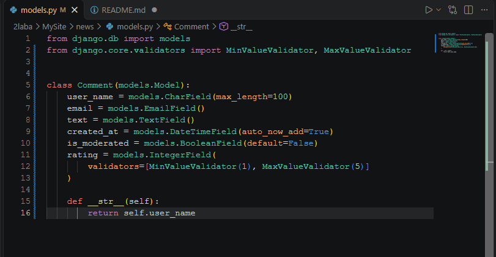

### 2.2. Создание и применение миграций

После создания модели необходимо было внести соответствующие изменения в базу данных.

Сначала была выполнена команда:

```bash
python manage.py makemigrations news
```

В результате Django обнаружил новую модель и создал файл миграции.

*Рисунок 2 — Создание миграции.*

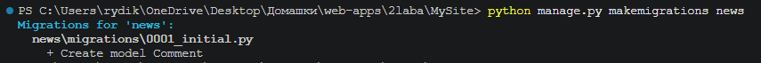

Затем была выполнена команда:

```bash
python manage.py migrate
```

Она применила созданную миграцию и создала соответствующую таблицу в базе данных SQLite.

*Рисунок 3 — Применение миграций.*

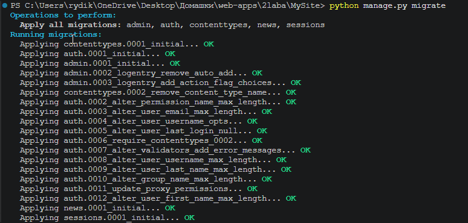

Для просмотра SQL-запроса, соответствующего миграции, была использована команда:

```bash
python manage.py sqlmigrate news 0001
```

Она позволяет увидеть SQL-код, который Django использует для создания таблицы и её полей.

*Рисунок 4 — SQL-запрос миграции.*

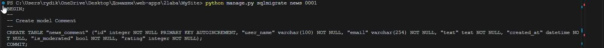

### 2.3. Работа с базой данных через Django Shell

Для выполнения операций с моделью была запущена интерактивная консоль Django:

```bash
python manage.py shell
```

После запуска консоли была импортирована модель:

```python
from news.models import Comment
```

*Рисунок 5 — Запуск Django Shell и импорт модели.*

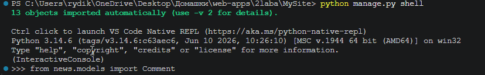

**Создание записей (Create)**

Для заполнения базы данных были созданы три комментария с помощью метода `objects.create()`:

```python
Comment.objects.create(
    user_name="Александр",
    email="alex@mail.ru",
    text="Отличный сайт!",
    is_moderated=True,
    rating=5
)

Comment.objects.create(
    user_name="Иван",
    email="ivan@mail.ru",
    text="Есть над чем поработать.",
    is_moderated=False,
    rating=3
)

Comment.objects.create(
    user_name="Мария",
    email="maria@mail.ru",
    text="Мне всё понравилось!",
    is_moderated=True,
    rating=4
)
```

Метод `objects.create()` создаёт новый объект и сразу сохраняет его в базе данных.

*Рисунок 6 — Создание комментариев.*

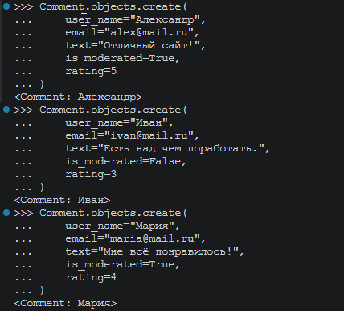

**Получение записей (Read)**

Для получения всех комментариев использовалась команда:

```python
Comment.objects.all()
```

Для получения комментариев, прошедших модерацию:

```python
Comment.objects.filter(is_moderated=True)
```

Для получения конкретного комментария по его идентификатору:

```python
Comment.objects.get(pk=1)
```

Метод `all()` возвращает все записи, `filter()` позволяет выбрать записи по условию, а `get()` используется для получения одного конкретного объекта.

*Рисунок 7 — Получение и фильтрация комментариев.*

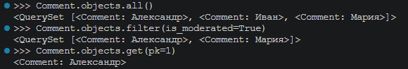

**Изменение записей (Update)**

Для изменения комментария сначала был получен объект из базы данных, после чего изменена его оценка:

```python
comment = Comment.objects.get(pk=1)
comment.rating = 4
comment.save()
```

Метод `save()` сохраняет внесённые изменения в базе данных.

Для проверки результата была выполнена команда:

```python
Comment.objects.get(pk=1).rating
```

*Рисунок 8 — Изменение комментария.*

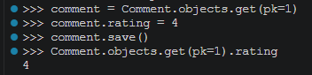

**Удаление записей (Delete)**

Для удаления комментария использовался метод `delete()`:

```python
comment = Comment.objects.get(pk=2)
comment.delete()
```

После удаления была выполнена проверка оставшихся записей:

```python
Comment.objects.all()
```

*Рисунок 9 — Удаление комментария.*

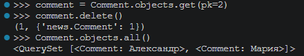

### 2.4. Фильтрация и исключение записей

Для дополнительной проверки работы Django ORM были использованы методы `exclude()` и `filter()`.

Исключение комментариев с оценкой 5:

```python
Comment.objects.exclude(rating=5)
```

Получение комментариев с оценкой не ниже 4:

```python
Comment.objects.filter(rating__gte=4)
```

Метод `exclude()` исключает записи, соответствующие заданному условию. Выражение `rating__gte=4` позволяет получить комментарии, оценка которых больше или равна 4.

*Рисунок 10 — Использование методов фильтрации и исключения.*

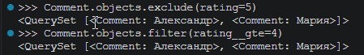

### 2.5. Настройка административной панели Django

Для управления комментариями через административную панель был создан суперпользователь командой:

```bash
python manage.py createsuperuser
```

*Рисунок 11 — Создание суперпользователя.*

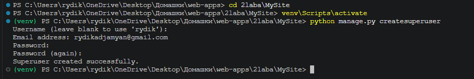

Затем в файле `news/admin.py` была зарегистрирована модель `Comment`:

```python
from django.contrib import admin
from .models import Comment

admin.site.register(Comment)
```

*Рисунок 12 — Регистрация модели Comment.*

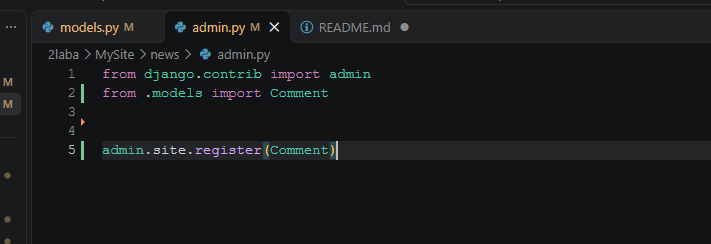

После запуска сервера командой `python manage.py runserver` была открыта административная панель по адресу:

```text
http://127.0.0.1:8000/admin/
```

После авторизации под суперпользователем стала доступна модель `Comment`.

*Рисунок 13 — Административная панель Django.*

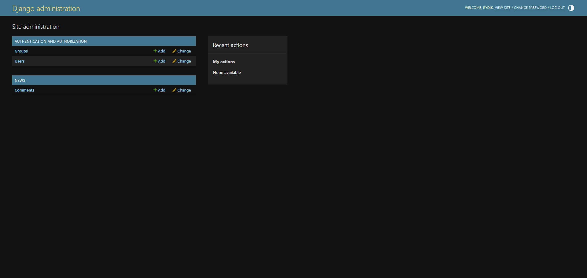

В административной панели был открыт список комментариев.

*Рисунок 14 — Список комментариев.*

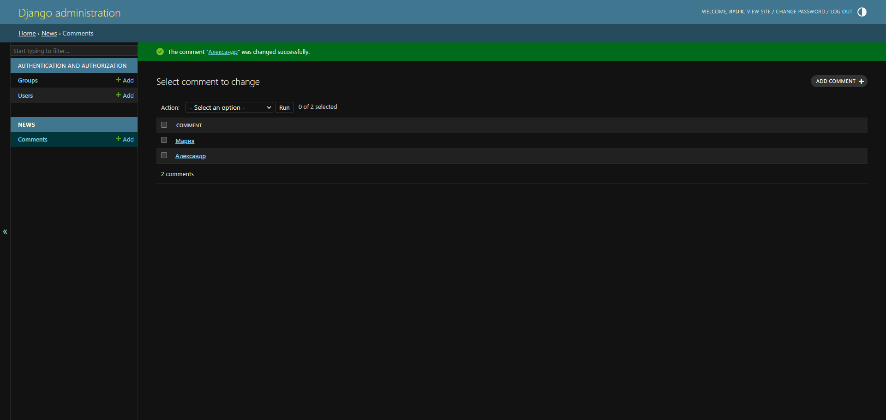

Также была проверена форма добавления нового комментария через административную панель.

*Рисунок 15 — Форма добавления комментария.*

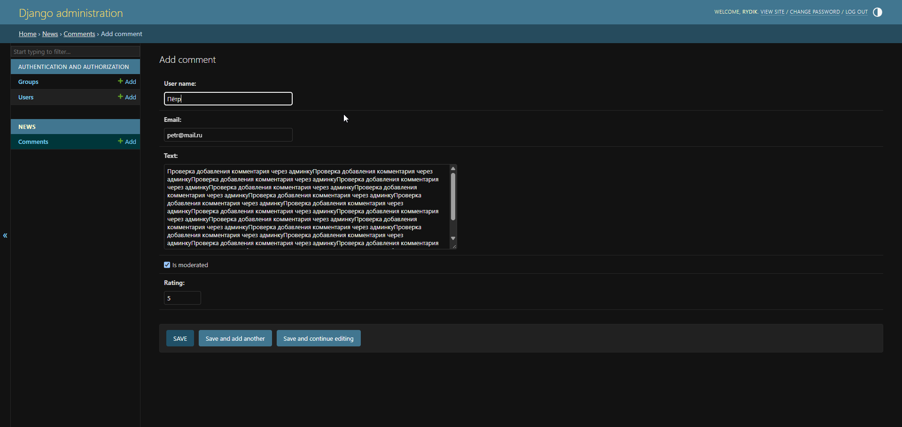

### 2.6. Выполнение индивидуального задания и проверка валидаторов

Основное требование варианта № 3 — вывести все комментарии, прошедшие модерацию.

Для этого в Django Shell был выполнен следующий код:

```python
from news.models import Comment

moderated_comments = Comment.objects.filter(is_moderated=True)

for comment in moderated_comments:
    print(comment.user_name, comment.email, comment.rating)
```

Запрос `filter(is_moderated=True)` выбирает только те комментарии, у которых статус модерации установлен в `True`.

*Рисунок 16 — Вывод комментариев, прошедших модерацию.*

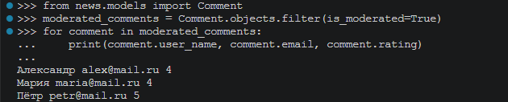

Дополнительно была проверена работа валидаторов поля `rating`.

Для проверки был создан объект с недопустимой оценкой, равной 6:

```python
comment = Comment(
    user_name="Тест",
    email="test@mail.ru",
    text="Проверка валидатора",
    rating=6
)

comment.full_clean()
```

При выполнении `full_clean()` Django проверил поля модели и обнаружил, что значение оценки превышает установленный максимум. В результате было вызвано исключение `ValidationError`.

Это подтвердило корректную работу ограничений `MinValueValidator` и `MaxValueValidator`.

*Рисунок 17 — Проверка валидатора оценки.*

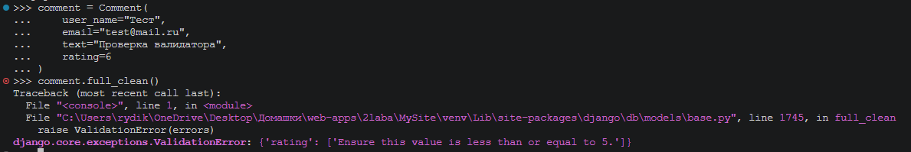

---

## 3. Ответы на контрольные вопросы

**1. Что такое модель в Django и для чего она используется?**

Модель — это Python-класс, наследующийся от `models.Model`. Она описывает структуру данных, которые хранятся в базе данных. Каждая модель обычно соответствует отдельной таблице.

**2. Какие типы полей вы знаете? Приведите примеры.**

- `CharField` — строка ограниченной длины.
- `TextField` — текст большого объёма.
- `IntegerField` — целое число.
- `BooleanField` — логическое значение.
- `DateTimeField` — дата и время.
- `EmailField` — адрес электронной почты.
- `ImageField` — поле для хранения изображения.

**3. Чем отличаются параметры blank=True и null=True?**

`blank=True` разрешает оставлять поле незаполненным при проверке данных на уровне форм и валидации.

`null=True` разрешает хранить в соответствующем столбце базы данных значение `NULL`.

**4. Что такое миграции и зачем они нужны? Опишите основные команды для работы с ними.**

Миграции — это механизм Django для переноса изменений моделей в структуру базы данных.

Основные команды:

- `makemigrations` — создание файлов миграций;
- `migrate` — применение миграций;
- `sqlmigrate` — просмотр SQL-запросов конкретной миграции.

**5. Как создать суперпользователя для доступа к административной панели Django?**

Для создания суперпользователя необходимо выполнить команду:

```bash
python manage.py createsuperuser
```

Затем указать имя пользователя, электронную почту и пароль. Созданный пользователь получает административные права.

**6. Что такое ORM? Перечислите основные методы для выполнения операций CRUD.**

ORM — это технология взаимодействия с базой данных через объекты и методы Python.

Основные методы:

- Create — `create()`, `save()`;
- Read — `all()`, `filter()`, `get()`;
- Update — изменение атрибутов объекта и вызов `save()`;
- Delete — `delete()`.

**7. В чём разница между методами filter() и get()?**

`filter()` возвращает набор записей, соответствующих условию, в виде QuerySet.

`get()` возвращает один объект. Если объект не найден или найдено несколько объектов, Django вызывает исключение.

**8. Как настроить загрузку изображений (медиафайлов) в проекте Django?**

Для загрузки изображений используется поле `ImageField`. Необходимо установить библиотеку Pillow, а в `settings.py` определить:

```python
MEDIA_ROOT = os.path.join(BASE_DIR, 'media')
MEDIA_URL = '/media/'
```

В корневом `urls.py` в режиме отладки добавляется маршрут с использованием `static()` из `django.conf.urls.static`.

**9. Для чего нужен метод __str__ в модели?**

Метод `__str__()` задаёт строковое представление объекта модели. Он позволяет отображать понятное название объекта вместо стандартного представления Django.

**10. Что произойдёт, если выполнить python manage.py makemigrations, но не выполнить migrate?**

Django создаст файл миграции с описанием изменений, но сама структура базы данных не изменится. Для применения этих изменений необходимо выполнить команду `migrate`.

---

## 4. Вывод

В ходе лабораторной работы была создана модель `Comment` в приложении `news` в соответствии с индивидуальным вариантом № 3. Для модели были определены поля пользователя, электронной почты, текста комментария, даты создания, статуса модерации и оценки.

Были созданы и применены миграции, после чего выполнена работа с базой данных через Django Shell. С помощью Django ORM были проверены операции создания, получения, изменения и удаления записей, а также методы фильтрации и исключения.

Дополнительно была настроена административная панель Django, создан суперпользователь и зарегистрирована модель комментариев. Проверена возможность управления записями через графический интерфейс.

В результате выполнения индивидуального задания был получен список комментариев, прошедших модерацию. Также была проверена работа валидаторов, ограничивающих оценку диапазоном от 1 до 5.

В ходе работы были получены практические навыки создания моделей Django, выполнения миграций, работы с базой данных и использования Django ORM.